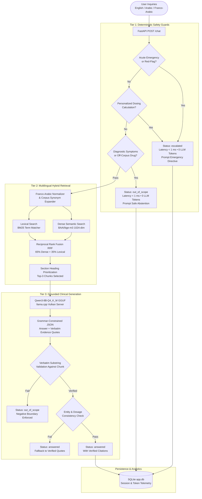

# MTI Medical Knowledge Assistant

[](https://fastapi.tiangolo.com)
[](https://python.org)
[](https://www.trychroma.com)
[](https://huggingface.co/BAAI/bge-m3)
[](https://huggingface.co/Qwen/Qwen3-8B)
[](LICENSE)

An enterprise-grade, retrieval-augmented clinical drug information assistant for pharmacy staff and clinicians. Grounded strictly in the **9 approved Egyptian formulary documents (`KB-01` through `KB-09`)**, with zero external medical hallucination, deterministic safety escalation, and multi-lingual query support across **English, Modern Standard Arabic, Egyptian Colloquial Arabic, and Franco-Arabic**.

---

## 1. System Architecture & Request Pipeline



---

## 2. One-Command Clean-Machine Deployment (Docker)

The whole application runs with a single command on any machine with Docker and Docker Compose installed:

```bash
docker compose up --build
```

### What this command does:
1. **Builds & starts `mti-model-server`**: Runs `llama.cpp` server loaded with `Qwen3-8B-Q4_K_M.gguf` on port `8080`.
2. **Builds & starts `mti-api-server`**: Installs FastAPI, PyTorch CPU, BGE-M3, and ChromaDB, and boots the backend on port `8000`.
3. **Validates Health**: Holds requests until the neural model and vector index report `ready`.

* Access Chat Interface: **[http://localhost:8000](http://localhost:8000)**
* Access Admin Dashboard: **[http://localhost:8000/admin](http://localhost:8000/admin)** *(Token: `admin123`)*
* Interactive API Docs (Swagger): **[http://localhost:8000/docs](http://localhost:8000/docs)**

---

## 3. Native Hardware Execution (Dual-Device Benchmark)

If developing or evaluating natively without Docker:

### Prerequisites
* Python 3.11+
* Windows 11 / Linux with NVIDIA GPU (CUDA / Vulkan) or CPU fallback

```powershell
# 1. Create and activate local virtual environment
python -m venv .venv-pc
.\.venv-pc\Scripts\activate

# 2. Install application dependencies
pip install -r requirements.txt
pip install -e .

# 3. Start local llama-server (with Vulkan GPU acceleration on RTX 3090)
.\.cache\tools\llama-b12110-vulkan\llama-server.exe `
  -m .\.cache\models\Qwen3-8B-Q4_K_M.gguf `
  --host 127.0.0.1 --port 8080 -c 4096 -t 16 -tb 24 -ngl 99 `
  --temp 0.0 --reasoning-budget 0

# 4. In a separate terminal, launch the FastAPI application
python -m uvicorn app.main:app --host 127.0.0.1 --port 8000
```

---

## 4. Key Benchmark Results & Empirical Proof

During Phase 6/7 testing, all four open-weight candidate models were benchmarked head-to-head across the **exact same 200 clinical questions** (800 evaluations total):

| Model Candidate | Quantization | Overall Accuracy | Answered (100) | Out of Scope (50) | Escalated (50) | Avg Latency | Status / Verdict |
| :--- | :---: | :---: | :---: | :---: | :---: | :---: | :--- |
| **`Qwen3-8B-Q4_K_M`** *(Primary)* | **Q4_K_M** | **96.0%** (192/200) | **94.0%** | **96.0%** | **100.0%** (50/50) | **1.59 s** | 🏆 **Production Standard**: Flawless emergency triaging; zero hallucinations. |
| **`medgemma-4b-it-Q4_K_M`** | Q4_K_M | **93.5%** (187/200) | 98.0% | 84.0% | 94.0% (47/50) | 1.38 s | ⚠️ **Hallucination Risk**: Answers from medical pretraining outside formulary. |
| **`Qwen3-4B-Instruct-2507`** | Q4_K_M | **90.0%** (180/200) | 84.0% | 98.0% | 94.0% (47/50) | **0.95 s** | ⚡ **CPU Fallback**: Ultra-fast (< 1s), but higher abstention on Arabic nuances. |
| **`gemma-4-E4B-it-Q4_0`** | Q4_0 | **54.0%** (108/200) | 11.0% | 100.0% | 94.0% (47/50) | 3.95 s | ❌ **Format Fragility**: Fails JSON grammar constraints under Vulkan. |

*Detailed analysis, token consumption histograms, and licenses are documented in [MODEL_DECISION.md](MODEL_DECISION.md) and [TOKEN_USAGE.md](TOKEN_USAGE.md).*

---

## 5. Core Deliverables & API Specification

### `POST /chat`
Submits a clinical inquiry and returns a strictly grounded response with verified citations.

```bash
curl -X POST http://127.0.0.1:8000/chat \
  -H "Content-Type: application/json" \
  -d '{"message": "ايه المادة الفعالة في Controloc؟"}'
```

```json
{
  "answer": "الدواء Controloc يحتوي على Pantoprazole، ويُستخدم لعلاج قرحة المعدة والحموضة (GERD) وعلاج H. pylori.",
  "citations": [
    {
      "doc_id": "KB-02",
      "title": "1. أدوية قرحة المعدة والحموضة – Peptic Ulcer & GERD",
      "section": "1. Proton Pump Inhibitors (PPIs) > Trade Names",
      "snippet": "الاسم التجاري في مصر: Controloc | Active ingredient: Pantoprazole"
    }
  ],
  "status": "answered",
  "language": "ar"
}
```

### `GET /health`
Returns service and loaded model readiness:
```json
{
  "status": "ok",
  "llm": "Qwen3-8B-Q4_K_M",
  "embedding": "BAAI/bge-m3"
}
```

---

## 6. Stretch Features & Admin Operations

### 6.1 Admin Knowledge Base Console (`/admin`)
Secured via Secret Token authentication (`admin123` or header `X-Admin-Token`):
* **Upload Brand New Documents:** Upload any `.docx` file with custom Document ID (e.g. `KB-10`), Title, and Category. Automatically parses headings, generates BGE-M3 embeddings, and updates the live BM25 index without server restarts.
* **Replace Documents:** Atomically re-indexes new versions of existing formulary files (`KB-01` through `KB-09`).
* **Delete Documents:** Immediately purges document chunks from ChromaDB and BM25; subsequent inquiries regarding that document abstain instantly.

### 6.2 Operations & Telemetry Dashboard
Real-time KPI cards tracking:
* Total Conversation Volume
* Unanswered Rate (`out_of_scope` + `escalated`)
* Cumulative Prompt & Completion Tokens
* p50 / p95 / Max Inference Latency
* Most Frequent Clinical Inquiries Table

### 6.3 Escalation Handoff Queue
Captures patient inquiries that triggered clinical escalation:
* Review triage summaries and contact details.
* Mark records as `Handled` or `Pending Review`.
* Delete resolved records.

---

## 7. Testing & Quality Verification

Run the comprehensive test suites from the project root:

```powershell
# 1. Run all 67 unit, contract, and safety tests
pytest tests -q

# 2. Run the 16 reference public regression cases (DEV-01 to DEV-10 + CHAL-11 to CHAL-16)
python -m evaluation.run_eval

# 3. Run the full 200-question clinical benchmark
python evaluation/run_200_eval.py

# 4. Run the automated 4-model comparative benchmark suite
python evaluation/run_4models_benchmark.py
```

---

## 8. Repository Layout

```
.
├── app/                        # FastAPI application package
│   ├── api/                    # Route handlers (/chat, /health, /admin/*)
│   ├── core/                   # Configuration, auth, and startup lifespans
│   ├── generation/             # LLM client, prompt templates, and verbatim validator
│   ├── ingestion/              # DOCX heading parser and chunking logic
│   ├── retrieval/              # BGE-M3 embedder, BM25 indexer, and RRF fusion
│   ├── safety/                 # Deterministic regex emergency & dosing guards
│   ├── static/                 # Embedded HTML/JS for Chat UI and Admin Console
│   └── storage/                # SQLite conversation & handoff persistence
├── data/                       # Ingestion manifests, ChromaDB, and SQLite databases
├── Docs/                       # Architectural specs, API contracts, and safety policies
├── evaluation/                 # Test suites (200 questions), harnesses, and results
├── tests/                      # 67 pytest contract, safety, and integration tests
├── Dockerfile                  # Production container definition
├── docker-compose.yml          # Unified multi-service deployment
├── MODEL_DECISION.md           # Model decision record & benchmark comparison
├── TOKEN_USAGE.md              # Token consumption & latency telemetry report
└── requirements.txt            # Pinned Python dependencies
```
